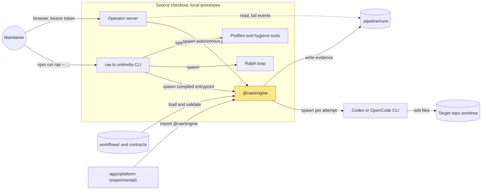
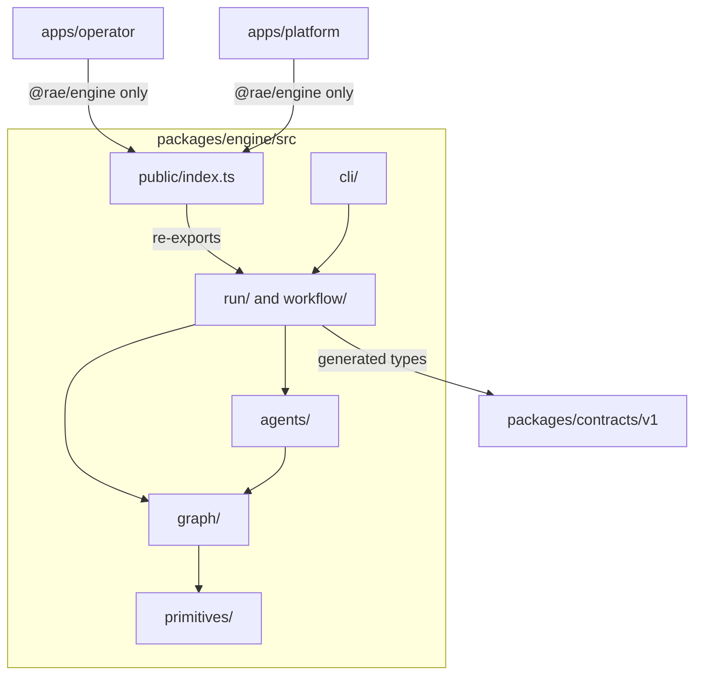
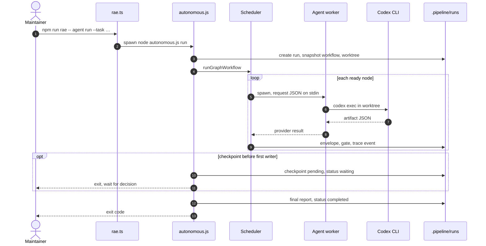
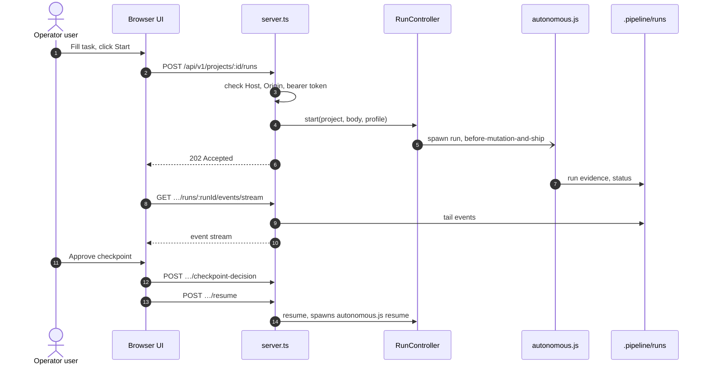
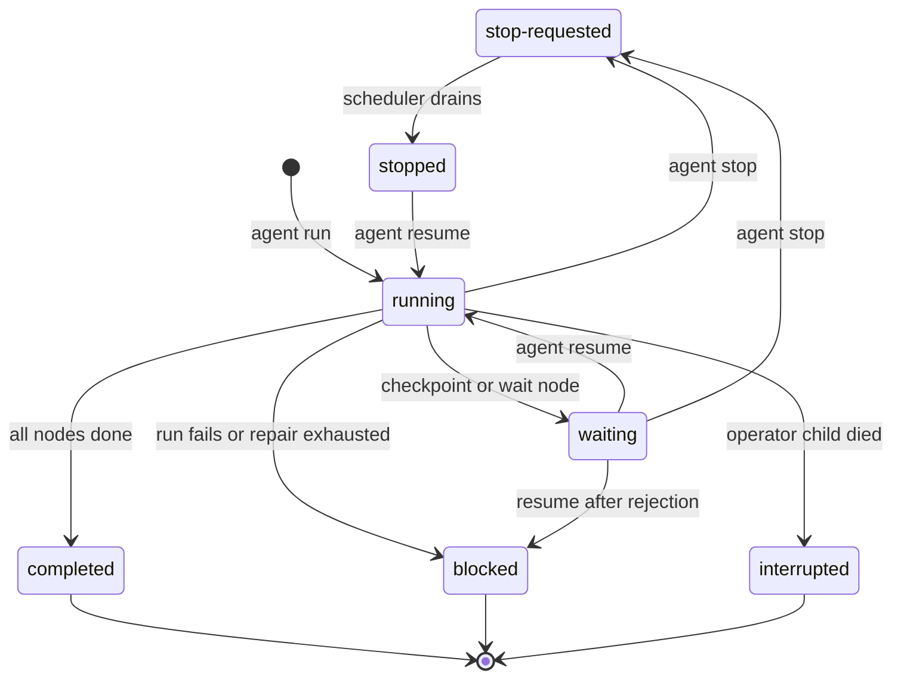
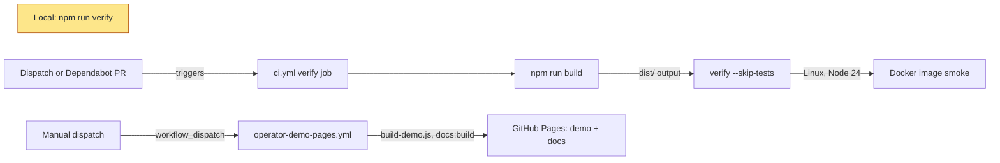

# Architecture

RAE is a local-first repository-automation system. Its reusable engine validates
versioned workflows and contracts, executes bounded work through provider
processes and deterministic tools, and records local evidence. Applications sit
outside the engine, Ralph retains an independent transaction model, and the
hosted platform remains an experimental adapter rather than a deployed RAE
service.

Read this page top to bottom: what runs where, the two main user journeys
(`agent run` from the terminal and "Start run" in the operator console), the
lifecycle of a run, where state lives, and how the repository is checked and
published.

## Component model

What runs on the maintainer's machine, and how the pieces talk to each other:

Every user command enters through `rae.ts`, which only routes: it starts the
compiled engine, Ralph, profile or hygiene entry point as a child process and
forwards its exit code. The engine is the only component that schedules
provider work and writes run evidence. The operator never runs workflow code in
its own process; it starts the same autonomous CLI as a child and reads the
files that child writes under `.pipeline/runs/`.

Where in the code:

- [scripts/src/rae.ts](../scripts/src/rae.ts): command routing (`main`, `engineEntry`, `execute`)
- [packages/engine/src/public/index.ts](../packages/engine/src/public/index.ts): the only importable engine surface, including the compiled entry-point paths
- [apps/operator/server.ts](../apps/operator/server.ts) and [apps/operator/lib/control.ts](../apps/operator/lib/control.ts): HTTP server and run process control
- [workflows/graph-native-default.workflow.json](../workflows/graph-native-default.workflow.json): the default workflow

| Component | Responsibility | Build or operation boundary |
| --- | --- | --- |
| `scripts/src/rae.ts` | Routes user commands to the owning runtime | Source-checkout entry point |
| `packages/engine/` | Workflows, scheduling, providers, run state, graph projection, gates, and evidence | Private root npm workspace package |
| `packages/contracts/v1/` | Versioned JSON Schemas crossing package and process boundaries | Private root workspace package; existing versions are immutable |
| `workflows/` | Committed workflow topology and policy | Engine-owned data, not executable provider code |
| `experiments/` | Repository-owned frozen task suites and preregistered experiment designs | Data, not code; read by the engine experiment runner |
| `apps/operator/` | Authenticated loopback run and workflow interface | Private root workspace application |
| `apps/platform/` | PostgreSQL control plane, HTTP/MCP API, object storage, and remote worker | Experimental package with a separate lockfile |
| `packages/ralph/` | Story selection, read-only audit/lint, and recoverable fixing transactions | Independent TypeScript runtime |
| `packages/dev-tools/` | Deterministic quality, review, and trace processors | Root workspace packages invoked through JSON lines |
| `integrations/agent-adapters/` | Source templates, manifest, generator, and derived runner guidance | Generated-content boundary |
| `profiles/agent-environments/` | Sanitized profile templates and transactional installers | Independent filesystem-mutating tool |
| `tools/repo-hygiene/` | Narrow maintenance utilities | Independent tool; one utility rewrites Git history |

## Dependency direction

Which code may import which (every arrow is an allowed import):

Lower layers may be imported from any higher layer, so `run/` may also import
`primitives/` directly; the diagram shows only the layer order.

`packages/engine/src/public/index.ts` is the sole supported JavaScript import
surface. Everything else below `packages/engine/src/` is private. Applications
must not import engine source paths, and the engine must not depend on
applications, Ralph, profiles, maintenance tools, integrations, or developer
tool source paths. Executable tools used at runtime are declared package
dependencies. Inside the engine, imports follow the arrows above: `run/` and
`workflow/` are one layer, and `primitives/` depends on nothing else in the
engine.

`npm run check:architecture` (`scripts/src/architecture-check.ts`) enforces
these rules. It ranks the engine layers `primitives`, `graph`, `agents`,
`run` and `workflow`, and `cli` from lowest to highest and rejects an import
of a higher layer. It rejects engine imports of `apps/`, Ralph, developer
tools, profiles, maintenance tools, and their packages, and it rejects any
import by `apps/` or Ralph source of an `@rae/engine/...` subpath or an
engine source file. The experimental platform also imports `@rae/fs-bridge`
directly for descriptor-relative staging and attempt files; that package is a
native primitive outside the engine, so the import is an accepted exception
to the "applications import only `@rae/engine`" rule.

## Autonomous run flow

1. The CLI resolves an explicit workflow, an activated local revision, or
   `workflows/graph-native-default.workflow.json`.
2. The workflow contract is canonicalized, schema-validated, digested, and
   copied into the run as an immutable snapshot.
3. The scheduler orders typed edges, caps read concurrency, serializes shared
   resources, and drains readers before an exclusive writer.
4. A provider worker receives the task, predecessor context, node guidance,
   and an output schema. The default `--context-mode legacy` inlines full
   predecessor envelopes; `--context-mode bounded` is opt-in and limits the
   context. Each attempt uses a fresh provider session.
5. The engine validates the returned artifact and node envelope. Read nodes are
   checked for repository mutation; writer results are checked against the
   ownership plan and Git invariants.
6. Attempts, events, gates, checkpoints, traces, and the final report are
   written under `.pipeline/runs/<run-id>/`.
7. Optional graph projection derives queryable context from repository and run
   evidence. It never authorizes mutation or replaces raw artifacts and gates.

New autonomous runs use an isolated `pipeline/<run-id>` branch and worktree
under the target repository's Git metadata by default. The ten-stage v1 engine
is retained only for explicit `--legacy-linear` runs and existing v1 resumes.
Workflow 2.2 adds experimental local wait-and-signal behavior without changing
stored 2.0 or 2.1 runs.

### What happens on `npm run rae -- agent run`

The same flow as a sequence of processes and files:

Steps 3–4 correspond to items 1–2 of the list above: `initializeOrResume`
creates or reopens the run directory and worktree, then `runGraphWorkflow`
hands the validated workflow to the scheduler. Each provider attempt (steps
5–8) runs in a fresh worker process that leads its own process group, so a
timeout or stop kills the provider and everything it started. The default
checkpoint policy `before-mutation` pauses before the first writer: the CLI
records a pending checkpoint, sets the run to `waiting` and exits. A later
`agent resolve-checkpoint` followed by `agent resume` continues from the stored
envelopes.

Where in the code:

- [packages/engine/src/cli/autonomous.ts](../packages/engine/src/cli/autonomous.ts): `main` dispatches `run`, `resume`, `status`, `stop` and checkpoint commands
- [packages/engine/src/run/autonomous-actions.ts](../packages/engine/src/run/autonomous-actions.ts): `runWorkflow`, checkpoint handling and `completeGraphRun`
- [packages/engine/src/run/autonomous-lifecycle.ts](../packages/engine/src/run/autonomous-lifecycle.ts): `initializeOrResume`, worktree creation and run lock
- [packages/engine/src/workflow/workflow-runtime.ts](../packages/engine/src/workflow/workflow-runtime.ts): `runGraphWorkflow`, `runWorker`, payload validation and gates
- [packages/engine/src/workflow/workflow-scheduler.ts](../packages/engine/src/workflow/workflow-scheduler.ts): `scheduleWorkflow`, concurrency and repair rounds
- [packages/engine/src/cli/workflow-agent-worker.ts](../packages/engine/src/cli/workflow-agent-worker.ts) → [agents/agent-executor.ts](../packages/engine/src/agents/agent-executor.ts) → [agents/codex-adapter.ts](../packages/engine/src/agents/codex-adapter.ts): one provider attempt
- [packages/engine/src/run/operator-control.ts](../packages/engine/src/run/operator-control.ts): run status and stop requests

### What happens on "Start run" in the operator console

The console reaches the same engine through an authenticated HTTP request:

`routeApi` rejects any request that fails the loopback `Host`/`Origin` check or
the bearer token before it reaches the controller (step 3). The controller
owns at most one child run at a time and starts it with the stricter
`before-mutation-and-ship` policy, so console runs pause before the first
writer and again before completion. Recording a decision (step 12) only writes
the checkpoint; the run continues when the user resumes it (steps 13–14). If
the owned child exits while the run is still `running` or `waiting`, the
controller marks it `interrupted`.

Where in the code:

- [apps/operator/static/js/start-actions.ts](../apps/operator/static/js/start-actions.ts): start form submission
- [apps/operator/server.ts](../apps/operator/server.ts): `handleOperatorRequest`, `routeApi`, event streaming
- [apps/operator/lib/security.ts](../apps/operator/lib/security.ts): loopback and bearer checks
- [apps/operator/lib/control.ts](../apps/operator/lib/control.ts): `RunController.start`, `resume`, `stop`, `decideCheckpoint`
- [apps/operator/lib/runs.ts](../apps/operator/lib/runs.ts) and [apps/operator/lib/tail.ts](../apps/operator/lib/tail.ts): reading runs and tailing events

### Run lifecycle

The states a run moves through, as stored in `operator-control.json`:

A `--through <node>` run that stops early also ends in `stopped`. `completed`, `blocked` and
`interrupted` are terminal: a stop request on them is rejected, and the
operator offers Cleanup only for those states and `stopped`. The allowed values
are fixed by the
[operator-control schema](../packages/contracts/v1/schemas/artifacts/operator-control.schema.json).

## Experiment flow

`rae experiment` runs preregistered comparisons over a frozen task suite. It
loads the experiment and verifies the pinned suite digest, plans an interleaved
trial order from the design seed, and materializes the target repository as a
fresh Git repository for each trial. Each trial is an ordinary autonomous run
with checkpoint policy `none`. The runner then collects the run evidence,
evaluates the acceptance checks, writes one trial record, and later derives the
report and benchmark card from the records. See
[Experiments 1.0 contracts](reference/contracts/experiments-v1.md) and
[Run an experiment](how-to/run-an-experiment.md).

## State ownership

| State | Owner and location | Authority |
| --- | --- | --- |
| Run requests, attempts, gates, events, traces, checkpoints, graph projection | Engine, `.pipeline/runs/<run-id>/` | Authoritative for that local run |
| Workflow revisions and activations | Human operator, Git common directory `rae-workflows/v2/` | Affects future runs only |
| Cross-run graph memory | Human operator, Git common directory `rae-memory/v1/` | Advisory; promotion and rejection are explicit |
| Experiment lock, trial records, logs, reports and exports | Engine experiment runner, `.pipeline/experiments/<experiment-id>/` | Authoritative for that experiment's trial records; reports are derived |
| Ralph PRD, reports, and runtime log | Ralph package or embedded installation | Separate from engine run state |
| Ralph fixing journals and immutable baselines | Private external transaction directory | Recovery authority for a fixing transaction |
| Hosted runs, leases, events, and artifact metadata | Experimental platform PostgreSQL | Hosted control-plane state only |
| Hosted artifact bytes and quarantine | Configured S3-compatible store | Accepted only after digest and size verification |

Workflow and memory registries use owner-only storage, locks, atomic writes, and
canonical digests. Runtime outputs, local caches, build outputs, RepoWise data,
and documentation builds are ignored and are not source dependencies.

## Application and integration boundaries

The operator binds to loopback, uses an ephemeral bearer token, validates
`Host` and `Origin`, and exposes a bounded `/api/v1` surface. Remote mode is
a fixed relay for a compatible `/api/v1` operator service; it is not a general
proxy.

The experimental platform exposes `/api/v2` and `/mcp`, protects hosted
routes with OIDC claims and scopes, and uses fenced worker leases. It is not
currently compatible with the operator's remote relay because no
`/api/v1`-to-`/api/v2` adapter exists. Its development Compose file starts
loopback PostgreSQL and MinIO dependencies only; it is not production
deployment configuration.

Provider execution is a data-transfer boundary. Codex runs require the engine's
documented sandbox capabilities. OpenCode is never selected by `auto`; write
routes require macOS, an isolated worktree, and the Seatbelt-based containment
backend. The custom command provider is an explicitly unsafe test integration.

## Build and deployment boundaries

The root lockfile installs the npm workspaces. `npm run build` validates the
engine and compiles the TypeScript development tools; it does not build the
platform. The platform has its own lockfile and is built with
`npm run build:platform`. The operator's static demo is a browser-only mock
with no repository or backend access. The documentation site is built for the
`/rae-agent-workflows/docs/` path under the same Pages site as the demo.

How a change is checked and what gets published:

The full gate, including all test suites, runs locally with
`npm run verify -- --skip-install` before a hand-off. The CI `verify` job runs
only on manual dispatch and on Dependabot pull requests to `main`, on Ubuntu
and macOS with Node 24 and 26. It installs both lockfiles, builds, runs the
gate without tests, and on Linux with Node 24 builds and smoke-tests the
platform and product-tool container images. The Pages workflow is started by
hand and publishes the static operator demo and the VitePress documentation
site. Nothing in this pipeline publishes a package or deploys a service.
CodeQL and OpenSSF Scorecard run as separate workflows.

Where in the code:

- [.github/workflows/ci.yml](../.github/workflows/ci.yml) and [.github/workflows/operator-demo-pages.yml](../.github/workflows/operator-demo-pages.yml)
- [scripts/src/verify.ts](../scripts/src/verify.ts): the repository gate behind `npm run verify`
- [scripts/src/build.ts](../scripts/src/build.ts): the root build

The supported release artifact is a reviewed source tag or source archive.
There is no production deployment procedure in this repository. The platform
Dockerfile and development Compose file provide build and local-integration
fixtures, not evidence of a deployed service.

## Invariants and extension points

- Add a new version instead of changing the meaning of an existing schema.
- Add workflows and recipes as data; do not put provider credentials or
  implementation details in workflow definitions.
- Add external applications against `@rae/engine`, not private modules.
- Change adapter templates or the manifest, then regenerate derived guidance.
- Keep graph context advisory and activation or publication human-owned.
- Keep applications, Ralph, profiles, and maintenance tools outside the engine
  dependency direction.
- Put shared engine helpers in the lowest engine layer that needs them rather
  than copying them; a new shared concept gets one module.
- Write maintained code in TypeScript; package scripts run compiled `dist/`
  output.

RAE does not claim provider-independent performance, production hosted
readiness, globally atomic multi-path Ralph promotion, or automatic Git
publication.

## Detailed references

- [System overview](reference/architecture/system-overview.md)
- [Module boundaries](reference/architecture/module-boundaries.md)
- [Workflow 2.0 and 2.1 contract](reference/contracts/workflow-v2.md)
- [Experiments 1.0 contracts](reference/contracts/experiments-v1.md)
- [Experimental hosted platform](reference/architecture/experimental-hosted-platform.md)
- Engine guide (`packages/engine/README.md` at the repository root)
- Operator guide (`apps/operator/README.md` at the repository root)
- Security policy (`SECURITY.md` at the repository root)
